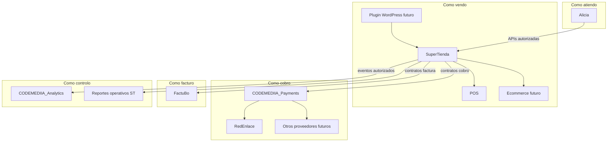

# ECOSYSTEM_ARCHITECTURE — Ecosistema CODEMEDIIA

**Versión:** 1.1 — 16 de noviembre de 2026  
**Producto núcleo en este repo:** SuperTienda  
**Empresa:** CODEMEDIIA

---

## Hechos verificados

- Este repositorio (`supertiendaweb`) implementa **solo** SuperTienda (frontend Next.js + backend Express/Prisma).
- No hay código de CODEMEDIIA Payments, FactuBo, Alicia, Analytics avanzado, plugin WordPress ni SDK de Red Enlace.
- Preparación parcial en SuperTienda: `FiscalSettings` / campos factura en `Sale`; enum `QR_PAYMENT`; OpenAPI/Swagger.
- Planes Emprendedor / Negocios / Empresarial no son apps separadas en el repo.

---

## Decisiones aprobadas

1. Ecosistema modular; productos contratables por separado o en paquetes.
2. **Cada producto (salvo el núcleo actual) vive en repositorio/proyecto independiente.**
3. Comunicación por APIs documentadas, contratos versionados y eventos autenticados cuando haga falta.
4. Separar estados: **pedido ≠ venta ≠ cobro ≠ factura**.
5. WordPress = canal; motor comercial = SuperTienda.
6. SuperTienda es el primer producto a desarrollar/completar.
7. Monolito modular en SuperTienda; sin microservicios innecesarios.
8. Red Enlace se integra en **CODEMEDIIA Payments**, no dentro de SuperTienda.
9. Menús digitales / restaurantes = producto o módulo futuro separado.
10. NFC = visión futura con puntos de extensión; no asumir terminal bancaria en el teléfono.

Detalle de fronteras: [`ECOSYSTEM_BOUNDARIES.md`](./ECOSYSTEM_BOUNDARIES.md).  
Contratos conceptuales: [`EXTERNAL_INTEGRATION_CONTRACTS.md`](./EXTERNAL_INTEGRATION_CONTRACTS.md).

---

## Recomendaciones técnicas

### Principios de frontera

1. **SuperTienda** — registro comercial (catálogo, stock, pedidos, POS, clientes, cajas, reportes operativos, offline individual).
2. **CODEMEDIIA Payments** — cobros, QR, conciliación, proveedores de pago; modelo inicial: integrador tecnológico (el comercio onboaardea con Red Enlace; CODEMEDIIA no custodia fondos).
3. **FactuBo** — emisión/validación fiscal boliviana.
4. **Alicia** — atención; consume APIs autorizadas de SuperTienda.
5. **CODEMEDIIA Analytics** — dashboards/MLOps futuros; consume eventos/datos autorizados.
6. SuperTienda **no** marca pagado solo por mostrar QR o por foto de comprobante.

### Evolución del monolito SuperTienda

- Conservar Express + Prisma + Next.js.
- Definir **puertos/contratos** hacia productos externos; no SDKs de Red Enlace en este repo.
- Clientes HTTP hacia Payments/FactuBo solo cuando existan esos productos y contratos aprobados.
- OpenAPI versionado como contrato estable.
- Bus de eventos / outbox cuando haya ≥2 consumidores reales.

### Menús digitales y NFC (visión)

Casos potenciales NFC: abrir menú, identificar mesa, abrir pedido, iniciar solicitud de cobro, fidelización, pagos contactless (solo con habilitación). Diferenciar enlace vs iniciador de operación vs pago bancario. **No desarrollar** en Fase 1.

---

## Funcionalidades futuras

- Implementación de repos Payments, FactuBo, Alicia, Analytics, menús digitales, plugin WordPress.
- Pasarela propia CODEMEDIIA sujeta a evaluación regulatoria.

---

## Decisiones pendientes

1. Nombres exactos de repositorios Git para Payments / FactuBo / Alicia.
2. Autenticación entre servicios (API keys vs OAuth2 client credentials vs mTLS).
3. ¿Eventos asíncronos desde el primer corte de integración o solo request/response + webhooks?
4. Tenant comercial unificado CODEMEDIIA vs solo SuperTienda por comercio.
5. Límites de planes comerciales para feature flags.
