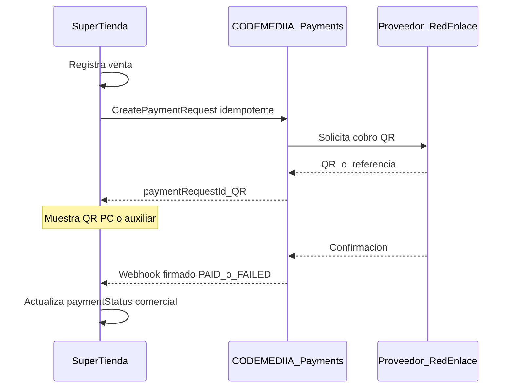

# EXTERNAL_INTEGRATION_CONTRACTS — Contratos conceptuales

**Versión:** 1.0 — 16 de noviembre de 2026  
**Producto:** SuperTienda by CODEMEDIIA  
**Naturaleza:** Contratos **conceptuales** — sin implementación, sin dependencias ejecutables, sin SDKs.

Ver también: [`ECOSYSTEM_BOUNDARIES.md`](./ECOSYSTEM_BOUNDARIES.md), [`INTEGRATION_STRATEGY.md`](./INTEGRATION_STRATEGY.md).

---

## Hechos verificados

- SuperTienda no tiene clientes HTTP hacia Payments/FactuBo/Alicia.
- Existen campos/enums locales (`QR_PAYMENT`, `FiscalSettings`, `paymentStatus`) útiles como anclas futuras.
- OpenAPI TSOA en `/api-docs` puede evolucionar a contrato público versionado.

---

## Decisiones aprobadas

1. Separar: **pedido ≠ venta ≠ solicitud de cobro ≠ referencia de transacción ≠ asignación de pagos ≠ factura**.
2. No asumir un solo pago o una sola factura por venta.
3. No confirmar pagos por visualizar QR ni por foto de comprobante.
4. Red Enlace y proveedores viven detrás de **CODEMEDIIA Payments**.
5. Auth entre servicios, idempotencia, webhooks autenticados, reintentos y auditoría son requisitos de diseño.
6. No implementar estos servicios en el repo SuperTienda durante Fase 1.

---

## Modelo conceptual de entidades

| Entidad | Dueño típico | Descripción |
|---------|--------------|-------------|
| `Order` / Pedido | SuperTienda | Intención de compra (POS, online, WP) |
| `Sale` / Venta | SuperTienda | Documento comercial; montos históricos inmutables |
| `PaymentRequest` | Payments (ST guarda ref) | Solicitud de cobro vinculada opcionalmente a venta/pedido |
| `TransactionReference` | Payments → ST | ID externo verificable del proveedor |
| `PaymentAllocation` | ST + Payments | Asignación de montos a una o varias ventas |
| `InvoiceRequest` / `InvoiceResult` | FactuBo (ST guarda refs) | Solicitud y resultado fiscal |

Estados sugeridos (cobro): `CREATED` → `QR_READY` → `PENDING` → `PAID` | `FAILED` | `EXPIRED` | `CANCELLED` | `PARTIALLY_PAID`.

Estados sugeridos (factura): `NOT_REQUESTED` → `QUEUED` → `ISSUED` | `REJECTED` | `CONTINGENCY`.

---

## Contrato A — CODEMEDIIA Payments

### Flujo objetivo

### Operaciones conceptuales

| Operación | Dirección | Notas |
|-----------|-----------|-------|
| `CreatePaymentRequest` | ST → Pay | `businessId`, monto, moneda, `saleId?`, `orderId?`, `Idempotency-Key`, `clientReference` |
| `GetPaymentRequest` | ST → Pay | Consulta estado |
| `CancelPaymentRequest` | ST → Pay | Si aún no pagado |
| `PaymentStatusChanged` | Pay → ST | Webhook/evento autenticado |
| `UnassignedPaymentNotify` | Pay → ST | Cobro sin pedido previo (opcional) |

### Requisitos transversales

- Identificadores únicos globales (`paymentRequestId`, `transactionRef`).
- Idempotencia en create/cancel.
- Auth servicio-servicio (API key rotada u OAuth2 client credentials — por definir).
- Firma HMAC o JWT en webhooks; rechazo si replay.
- Reintentos con backoff; ST debe ser idempotente al aplicar webhook.
- Auditoría en ambos lados.
- Conciliación posterior: responsabilidad primaria Payments; ST expone ventas abiertas.

### Lo que SuperTienda almacena

- `externalPaymentRequestId`, `externalTransactionRef`, montos asignados, timestamps, último estado conocido.
- **No** almacena secretos del proveedor ni implementa protocolo Red Enlace.

---

## Contrato B — FactuBo

| Operación | Dirección | Payload mínimo |
|-----------|-----------|----------------|
| `RequestInvoice` | ST → FactuBo | Datos negocio, ítems, impuestos, `saleId`, `Idempotency-Key` |
| `GetInvoiceStatus` | ST → FactuBo | `invoiceRequestId` |
| `InvoiceStatusChanged` | FactuBo → ST | Folio/CUF/estado/PDF ref |

ST no bloquea obligatoriamente el cierre POS por demora de factura (cola), salvo regla comercial del negocio.

Numeración fiscal autoritativa: FactuBo (tras habilitación SIN).

---

## Contrato C — Alicia

| Operación | Dirección | Alcance inicial |
|-----------|-----------|-----------------|
| `ListProducts` / stock | Alicia → ST | Read, scope `catalog:read` |
| `GetOrderOrSaleStatus` | Alicia → ST | Read |
| `CreateLeadOrOrder` | Alicia → ST | Write acotado, auditoría |
| `sale.created` / `payment.updated` | ST → Alicia | Eventos opcionales |

Credenciales de **servicio**, nunca JWT de cajero humano reutilizado.

---

## Contrato D — WordPress (plugin CODEMEDIIA)

| Operación | Dirección | Notas |
|-----------|-----------|-------|
| Catálogo / stock | WP → ST | Read storefront |
| Create online order | WP → ST | Canal `WORDPRESS` |
| Start payment | WP → ST → Payments | WP no habla Red Enlace |
| Request invoice | WP → ST → FactuBo | Opcional post-pago |

---

## Contrato E — CODEMEDIIA Analytics

| Operación | Dirección | Notas |
|-----------|-----------|-------|
| `commerce.events` | ST → Analytics | `sale.completed`, `stock.low`, `sync.conflict`, etc. |
| Export batch | ST → Analytics | Read models autorizados |

Analytics no escribe reglas comerciales en ST.

---

## NFC — puntos de extensión (futuro)

| Caso | Contrato conceptual |
|------|---------------------|
| Abrir menú / mesa | Deep link → producto Menús |
| Abrir pedido/carrito | Tag → `Order` draft en ST o Menús |
| Iniciar cobro | Tag → `CreatePaymentRequest` vía Payments |
| Fidelización | Tag → `customerId` lookup en ST |
| Pago contactless bancario | Solo vía Payments + habilitación; fuera de ST |

---

## Recomendaciones técnicas

1. Versionar contratos (`2026-11`, semver o fecha) antes del primer cliente HTTP.
2. En Fase 1 de SuperTienda: preparar campos de referencia y estados; **no** clientes HTTP.
3. Documentar OpenAPI de ST como oferta hacia Alicia/WP/Analytics primero (ST es servidor).
4. Payments/FactuBo publicarán sus propios OpenAPI cuando existan esos repos.

---

## Funcionalidades futuras

- Implementación de clientes, firmas, sandboxes y conciliación.
- PIX/Binance/NFC pago tras validación.

---

## Decisiones pendientes

1. Estándar de auth entre servicios CODEMEDIIA.
2. Formato exacto de webhooks (CloudEvents vs payload propio).
3. ¿Un `Order` separado de `Sale` en schema ST?
4. SLA de reintentos y retención de eventos.
5. Ambientes sandbox compartidos entre productos.
