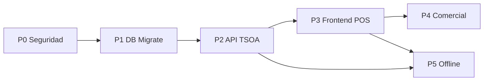

# PHASE_1_IMPLEMENTATION_PLAN — SuperTienda by CODEMEDIIA

**Versión:** 1.0 — 16 de noviembre de 2026  
**Estado:** Pendiente de aprobación explícita para implementar código  
**Repo:** `supertiendaweb`  
**Referencias:** [`MVP_ROADMAP.md`](./MVP_ROADMAP.md), [`TECHNICAL_DEBT.md`](./TECHNICAL_DEBT.md), [`ECOSYSTEM_BOUNDARIES.md`](./ECOSYSTEM_BOUNDARIES.md)

---

## 1. Objetivos del primer sprint / Fase 1

### Objetivo de negocio

Dejar SuperTienda **operable de punta a punta en modo online** para un comercio demo: login seguro, multiempresa real, catálogo/stock, caja, venta POS con cobro local (p. ej. efectivo), sin mocks en el flujo crítico.

### Objetivo técnico

Recuperar e integrar el código existente (servicios/controllers huérfanos + UI) sin reescribir el monolito.

### Alcance del primer paquete entregable

**P0 + P1 + P2 + P3** (seguridad → DB → API → frontend POS).

**P4 y P5** quedan documentados como continuación inmediata de Fase 1 (oleadas siguientes), no como parte del primer corte de aceptación online.

---

## 2. Tareas priorizadas

### Oleada A — Sprint 1: P0 Seguridad y aislamiento multiempresa

| ID | Tarea |
|----|-------|
| P0.1 | Restringir/eliminar bypass auth (`NEXT_PUBLIC_BYPASS_AUTH`, query/cookie) fuera de desarrollo local explícito |
| P0.2 | Proteger o eliminar `debug-auth` y `app/api/debug` en builds compartidos |
| P0.3 | Unificar storage de sesión a `auth_token` (FE + cookie + axios) |
| P0.4 | Eliminar `businessId = 1` y `userId = 1` hardcodeados; usar JWT |
| P0.5 | Enforcement básico de bearer en dominios TSOA; alinear roles |
| P0.6 | Quitar IP remota por defecto en rewrite; exigir `NEXT_PUBLIC_API_URL` en no-local |
| P0.7 | Revisar CORS/`JWT_SECRET` requirements por entorno |

### Oleada A — Sprint 1: P1 Integridad y base de datos

| ID | Tarea |
|----|-------|
| P1.1 | Definir estrategia Prisma Migrate (baseline desde schema o introspect) |
| P1.2 | Crear primera migración versionada; retirar `db push` del flujo de equipo |
| P1.3 | Documentar backup/restore PostgreSQL pre-migrate |
| P1.4 | Restaurar/definir relaciones e integridad de `InventoryTransaction` |
| P1.5 | Eliminar defaults peligrosos `businessId @default(1)` donde aplique |
| P1.6 | Seed mínimo: roles, permisos, business demo, usuario admin, productos muestra |

### Oleada B — Sprint 2: P2 API comercial

| ID | Tarea |
|----|-------|
| P2.1 | Convertir a TSOA / registrar: Customers |
| P2.2 | Cash registers (open/close/status) |
| P2.3 | Cart + POS + Sales (reutilizar `posService`, `saleService`, `cartService`) |
| P2.4 | Inventory (movimientos / receive PO según código existente) |
| P2.5 | Employees si la UI ya depende |
| P2.6 | Introducir `Idempotency-Key` / `clientOperationId` en mutaciones de venta |
| P2.7 | Regenerar `routes.ts` + OpenAPI; smoke en `/api-docs` |
| P2.8 | Prefijo `/api/v1` (o equivalente TSOA) al exponer dominios nuevos |

### Oleada B — Sprint 2: P3 Frontend funcional

| ID | Tarea |
|----|-------|
| P3.1 | Conectar `ventas` + `CartContext`/`PaymentPanel` a API POS |
| P3.2 | Completar transacción real (al menos efectivo); persistir Sale |
| P3.3 | Apertura/cierre de caja vía API; retirar stub Next `cash-registers/open` |
| P3.4 | Verificar descuento de stock post-venta |
| P3.5 | Clientes contra API real |
| P3.6 | Etiquetar o retirar mocks de movimientos/reportes en flujos críticos |

### Oleada C — Sprint 3: P4 Preparación comercial

| ID | Tarea |
|----|-------|
| P4.1 | Evaluar e implementar gaps: fotos, variantes, unidad/peso/volumen |
| P4.2 | Diseño importación masiva Excel/CSV (validación + anti-duplicados) |
| P4.3 | Moneda principal configurable; diseño multi-moneda + historial FX |
| P4.4 | Descuentos/promociones e impuestos alineados al schema |
| P4.5 | Reportes operativos reales (ventas del día, stock bajo) |
| P4.6 | Mejoras UI móvil (touch) en rutas POS |

### Oleada D — Sprint 4: P5 Offline individual

| ID | Tarea |
|----|-------|
| P5.1 | Persistencia local (IndexedDB) + snapshot catálogo |
| P5.2 | Outbox de ventas/ops + IDs únicos |
| P5.3 | Endpoints sync push/pull |
| P5.4 | UI de conexión/sync/conflictos + recuperación post-crash |
| P5.5 | Evaluación PWA documentada (límites reales) |
| P5.6 | Bloquear QR/pagos electrónicos offline |

---

## 3. Archivos afectados (principales)

### P0

- [`frontend/middleware.ts`](../frontend/middleware.ts)
- [`frontend/app/(auth)/login/page.tsx`](../frontend/app/(auth)/login/page.tsx)
- [`frontend/lib/auth-utils.ts`](../frontend/lib/auth-utils.ts)
- [`frontend/lib/api-client.ts`](../frontend/lib/api-client.ts)
- [`frontend/contexts/AuthContext.tsx`](../frontend/contexts/AuthContext.tsx)
- [`frontend/app/debug-auth/page.tsx`](../frontend/app/debug-auth/page.tsx)
- [`frontend/app/api/debug/route.ts`](../frontend/app/api/debug/route.ts)
- [`frontend/next.config.js`](../frontend/next.config.js)
- [`backend/src/services/authService.ts`](../backend/src/services/authService.ts)
- [`backend/src/middlewares/authMiddleware.ts`](../backend/src/middlewares/authMiddleware.ts)
- Controllers/services con `businessId = 1` (p. ej. Product/POS)

### P1

- [`backend/prisma/schema.prisma`](../backend/prisma/schema.prisma)
- Nuevo: `backend/prisma/migrations/**`
- Nuevo/restaurar: `backend/prisma/seed.ts`
- [`backend/package.json`](../backend/package.json) scripts `db:*`

### P2

- Controllers huérfanos → TSOA:  
  `posController`, `saleController`, `cartController`, `cashRegisterController`, `customerController`, `inventoryController`, `employeeController`
- Services: `posService`, `saleService`, `cartService`, `cashRegisterService`, `customerService`, `inventoryService`
- [`backend/src/app.ts`](../backend/src/app.ts) (solo `RegisterRoutes`; no reactivar legacy)
- Generados: [`backend/src/routes/routes.ts`](../backend/src/routes/routes.ts), `swagger.json`

### P3

- [`frontend/app/ventas/page.tsx`](../frontend/app/ventas/page.tsx)
- [`frontend/contexts/CartContext.tsx`](../frontend/contexts/CartContext.tsx)
- [`frontend/components/features/sales/PaymentPanel.tsx`](../frontend/components/features/sales/PaymentPanel.tsx)
- [`frontend/components/features/cash-register/**`](../frontend/components/features/cash-register/)
- [`frontend/app/api/cash-registers/open/route.ts`](../frontend/app/api/cash-registers/open/route.ts) (eliminar o proxy real)
- Services/hooks de customers, cash register, products

### P4–P5

- Schema + UI productos/import/reportes; nuevo módulo sync FE/BE; posible `manifest`/SW (evaluación).

---

## 4. Dependencias

- P2 depende de tenancy correcto (P0) y schema estable (P1).
- P3 depende de P2 (no cablear UI a endpoints inexistentes).
- P5 depende de idempotencia en P2 y POS online en P3.
- P4 puede solaparse parcialmente tras P3, pero import/variantes no bloquean el AC de POS efectivo.
- **No depende** de repos Payments/FactuBo/Alicia para P0–P3.

---

## 5. Riesgos

| Riesgo | Impacto | Mitigación |
|--------|---------|------------|
| Migración rompe DB existente | Alto | Backup + baseline migrate en copia; ensayo local |
| Controllers legacy incompatibles con TSOA | Medio | Reescribir thin controllers sobre services existentes |
| Hardcodes `businessId` ocultos | Alto | Grep + tests multi-business |
| Demo engañosa si quedan mocks | Medio | Checklist AC; banner en pantallas mock |
| Scope creep P4/P5/Payments | Alto | Fuera de alcance explícito abajo |
| JWT/keys distintas entre entornos | Medio | Documentar key management en P0 |

---

## 6. Pruebas

### P0

- Login sin bypass; acceso denegado sin cookie/token.
- Usuario de business A no ve datos de business B (smoke).
- Rewrite apunta a API local configurada.

### P1

- `prisma migrate deploy` en DB vacía y en copia de backup.
- Seed crea admin usable.
- FK de inventory transactions válidas.

### P2

- Swagger: open caja → start POS → add item → complete sale (efectivo).
- Reintento con misma `Idempotency-Key` no duplica venta.
- Stock `BusinessProduct` decrece.

### P3

- Flujo UI `/ventas` E2E idéntico al de Swagger.
- Stub `cash-registers/open` ya no responde datos falsos.
- Recarga de página: venta sigue en DB.

### P5 (posterior)

- Venta offline → restart browser → sync sin duplicar.

---

## 7. Criterios de aceptación (primer paquete P0–P3)

1. No hay bypass de auth activo en configuración de demo compartida / staging.
2. Tokens unificados; sesión coherente FE/middleware/API.
3. Ningún create operativo usa `businessId=1` / `userId=1` literales.
4. Existe historial Prisma Migrate versionado y procedimiento de backup documentado.
5. Endpoints TSOA vivos: customers, cash-registers, POS/sales (e inventory mínimo).
6. OpenAPI regenerado refleja esos endpoints.
7. Desde UI: abrir caja, vender con efectivo, ver stock actualizado y venta persistida.
8. Flujos críticos de POS sin `console.log`-checkout ni stubs Next de caja.
9. Ningún SDK Red Enlace / FactuBo / Alicia añadido al repo.

---

## 8. Estimaciones orientativas

Estimaciones en **días-persona** (1 desarrollador full-stack familiarizado con el repo). Margen ±40%.

| Oleada | Prioridades | Estimación |
|--------|-------------|------------|
| Sprint 1 | P0 + P1 | 5–8 días |
| Sprint 2 | P2 + P3 | 8–12 días |
| Sprint 3 | P4 (parcial MVP) | 6–10 días |
| Sprint 4 | P5 offline v1 | 8–14 días |
| **Primer paquete (P0–P3)** | | **13–20 días** |

No incluye: creación de repos Payments/FactuBo, onboarding Red Enlace, diseño UI nuevo desde cero, ni piloto en campo.

---

## 9. Decisiones pendientes

1. Aprobación explícita de CODEMEDIIA para iniciar código.
2. Vertical de datos seed/demo.
3. ¿Baseline migrate por introspect o reset controlado?
4. ¿Prefijo `/api/v1` obligatorio ya en P2? (**default del plan: sí**).
5. ¿Offline (P5) entra en el primer release vendible o en el inmediato siguiente?
6. ¿Quién administra entornos staging y secretos JWT?

---

## 10. Separación: alcance actual vs visión futura

### Alcance actual (Fase 1 SuperTienda — este plan)

- Seguridad, multiempresa, migraciones, API comercial, POS online FE, preparación comercial e offline individual.
- Contratos documentados hacia el ecosistema (sin implementar proveedores).

### Visión futura (otros repos / fases posteriores)

| Tema | Dónde |
|------|-------|
| CODEMEDIIA Payments + Red Enlace | Repo Payments |
| FactuBo / SIN | Repo FactuBo |
| Alicia | Repo Alicia |
| Analytics / MLOps | Repo Analytics |
| Plugin WordPress | Repo plugin |
| Menús digitales / NFC mesa | Producto separado |
| Offline multicaja LAN | Fase posterior SuperTienda |
| Feature flags por plan comercial | Tras validación comercial |
| Pasarela propia / custodia de fondos | Evaluación regulatoria |

### Prohibiciones explícitas en esta fase

- Modificar producción, instalar deps de pago, ejecutar migraciones en prod, commits/push sin autorización.
- Crear módulo de pagos con Red Enlace dentro de SuperTienda.
- Marcar ventas pagadas por UI de QR simulada.

---

## Hechos verificados (ancla)

El estado de partida es el auditado en Fase 0: API TSOA parcial; POS/caja/clientes/inventory con código no expuesto; checkout FE stub; sin offline; sin integraciones externas ejecutables.

---

## Recomendaciones técnicas

1. Un PR por oleada (P0, P1, P2, P3) para revisión controlada.
2. Preferir thin TSOA controllers sobre services existentes antes de reescribir dominio.
3. Tras cada oleada, actualizar [`FEATURE_INVENTORY.md`](./FEATURE_INVENTORY.md) estados.

---

**No comenzar implementación sin aprobación explícita de CODEMEDIIA.**
